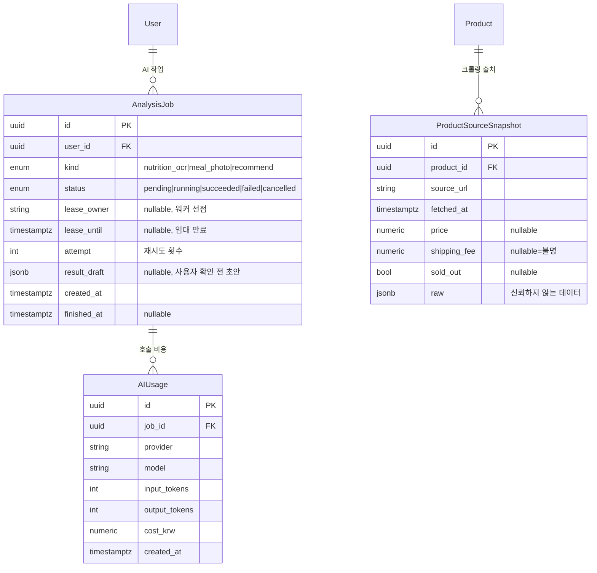

# 식단·재고·체중 관리 웹앱 — ERD (1차 범위 + 확장 참고)

버전: v0.1 초안 (2026-11-03) / 근거 문서: [`requirements-phase1.md`](requirements-phase1.md) §3 권고 엔터티, [`extension-todo.md`](extension-todo.md) 확장 공통 요구, 원본 [`archive/diet-app-requirements-v0.1.md`](archive/diet-app-requirements-v0.1.md)

표기 규칙은 요구사항 문서와 같다. ‘확정’은 사용자와 합의한 범위, ‘제안’은 구현 기본값, ‘미정’은 구현 전에 결정할 항목이다. 이 ERD는 권고 엔터티 목록을 속성·관계 수준으로 구체화한 **제안**이며, §5의 설계 전제는 사용자 확정 사항이 아니다.

- 1차 권고 엔터티 17개를 모두 포함한다. 추가로 `MealTemplateItem`, `IdempotencyKey` 2개를 제안한다(§5 A5·A6).
- 모든 사용자 데이터 테이블은 `user_id`를 가진다. 서버는 모든 조회·수정에서 `user_id`를 세션 사용자로 강제한다(NFR-04).
- 수량·영양은 `numeric`으로 정밀도를 유지하고 화면에서만 반올림한다. 입력되지 않은 값은 `null`이며 0과 구분한다(NFR-02).
- 시각은 `timestamptz`(UTC)로 저장하고, 식사·체중·완료의 날짜는 사용자 시간대 기준 `date`로 따로 둔다(NFR-02).

## 1. 1차 ERD (단계 0~2)

```mermaid
erDiagram
    User ||--o{ GoalHistory : "목표 이력"
    User ||--o{ Product : "소유"
    User ||--o{ Purchase : "구매"
    User ||--o{ StockReceipt : "입고"
    User ||--o{ StockMovement : "재고 원장"
    User ||--o{ MealTemplate : "식단"
    User ||--o{ WeeklySchedule : "주간 계획"
    User ||--o{ DateOverride : "날짜 예외"
    User ||--o{ MealRecord : "섭취 기록"
    User ||--o{ DayCompletion : "하루 완료"
    User ||--o{ WeightRecord : "체중"
    User ||--o{ NotificationSetting : "알림 설정"
    User ||--o{ PushSubscription : "푸시 구독"
    User ||--o{ NotificationDelivery : "알림 발송"
    User ||--o{ IdempotencyKey : "멱등성 키"

    Product ||--o{ ProductNutritionVersion : "영양 버전"
    Product ||--o{ Purchase : "구매 대상"
    Product ||--o{ StockReceipt : "입고 대상"
    Product ||--o{ StockMovement : "원장 대상"
    Product ||--o{ MealTemplateItem : "식단 구성"
    Product o|--o{ MealItemSnapshot : "참조(스냅샷)"
    Product o|--o{ NotificationDelivery : "소진 알림 대상"

    Purchase o|--o{ StockReceipt : "받았음 처리"
    StockReceipt ||--|| StockMovement : "입고 이동"

    MealTemplate ||--o{ MealTemplateItem : "품목"
    MealTemplate o|--o{ WeeklySchedule : "슬롯 배정"
    MealTemplate o|--o{ DateOverride : "예외 배정"
    MealTemplate o|--o{ MealRecord : "계획 출처"

    MealRecord ||--o{ MealItemSnapshot : "품목 스냅샷"
    MealItemSnapshot o|--o{ StockMovement : "차감·복구"
    MealRecord o|--o{ NotificationDelivery : "알림 대상 식사"

    User {
        uuid id PK
        string kakao_id UK
        string nickname
        string timezone "default Asia/Seoul"
        enum[] active_slots "쓰는 끼니, 기본 5개 (D-18)"
        timestamptz created_at
        timestamptz deleted_at "null=활성"
    }
    GoalHistory {
        uuid id PK
        uuid user_id FK
        date effective_from "UK(user_id, effective_from)"
        numeric target_weight_kg
        int daily_kcal
        numeric protein_g
        numeric carb_g "nullable"
        numeric fat_g "nullable"
        timestamptz created_at
    }
    Product {
        uuid id PK
        uuid user_id FK
        string name
        string brand "nullable"
        enum stock_unit "g|ml|ea, 재고 원장 단위. 이동 존재 시 변경 불가 (D-13)"
        string unit_label "ea일 때 표시 단위(팩·개·통), g/ml이면 null (D-11)"
        numeric units_per_package "포장 1개 = 재고 단위 N, 입고 = 구매 수량 x N (D-11)"
        numeric pack_weight_g "nullable, ea 1단위의 g, ea-g 변환 허용 조건"
        bool is_stock_tracked "소스=false"
        numeric default_serving_amount "nullable, 소스 기본 추정량, stock_unit 기준"
        string purchase_url "nullable"
        timestamptz created_at
        timestamptz archived_at
    }
    ProductNutritionVersion {
        uuid id PK
        uuid product_id FK
        numeric basis_amount "기준량"
        enum basis_unit "g|ml|ea, stock_unit과 같거나 g(pack_weight_g 있는 ea 제품) (D-11)"
        numeric kcal "nullable=미상"
        numeric carb_g "nullable"
        numeric protein_g "nullable"
        numeric fat_g "nullable"
        enum source "label|manual_estimate|ai_estimate"
        timestamptz created_at
        timestamptz superseded_at "null=현재 버전"
    }
    Purchase {
        uuid id PK
        uuid user_id FK
        uuid product_id FK
        numeric quantity "구매 수량(포장 단위)"
        date purchased_on
        numeric price "nullable"
        string url "nullable"
        enum status "ordered|received|cancelled"
        timestamptz created_at
    }
    StockReceipt {
        uuid id PK
        uuid user_id FK
        uuid product_id FK
        uuid purchase_id FK "nullable=기존 보유 초기 등록"
        numeric quantity "stock_unit 기준"
        timestamptz received_at
    }
    StockMovement {
        uuid id PK
        uuid user_id FK
        uuid product_id FK
        numeric delta "signed, stock_unit 기준"
        enum reason "receipt|initial|consume|consume_reverse|adjust|waste|other_use"
        uuid receipt_id FK "nullable"
        uuid meal_item_snapshot_id FK "nullable"
        string note "보정·폐기 사유"
        timestamptz created_at
    }
    MealTemplate {
        uuid id PK
        uuid user_id FK
        string name
        timestamptz created_at
        timestamptz archived_at
    }
    MealTemplateItem {
        uuid id PK
        uuid template_id FK
        uuid product_id FK
        numeric quantity
        enum unit "g|ml|ea, D-02 규칙"
        int sort_order
    }
    WeeklySchedule {
        uuid id PK
        uuid user_id FK
        smallint weekday "ISO 1=월..7=일, UK(user_id, weekday, slot) (D-17)"
        enum slot "breakfast|lunch|dinner|afternoon_snack|evening_snack"
        enum plan_type "template|none (D-19)"
        uuid template_id FK "nullable, plan_type=template일 때"
        timestamptz updated_at
    }
    DateOverride {
        uuid id PK
        uuid user_id FK
        date on_date "UK(user_id, on_date, slot)"
        enum slot
        enum plan_type "template|none (D-19)"
        uuid template_id FK "nullable"
        uuid batch_id "nullable, 출장 일괄 변경 묶음"
        string note "nullable"
        timestamptz created_at
    }
    MealRecord {
        uuid id PK
        uuid user_id FK
        date meal_date "사용자 시간대 기준"
        enum slot "5슬롯 + extra"
        int seq "정규 슬롯 0, extra 는 1,2,… UK(user_id, meal_date, slot, seq) (DEC-055)"
        enum status "unrecorded|eaten|skipped"
        enum kind "home|outside (D-17)"
        uuid template_id FK "nullable, 계획 출처"
        string outside_menu "nullable"
        numeric outside_kcal "nullable=미상"
        numeric outside_carb_g "nullable"
        numeric outside_protein_g "nullable"
        numeric outside_fat_g "nullable"
        bool plan_changed "계획 사전 변경 여부"
        int version "낙관적 잠금, 쓰기마다 +1 (D-08)"
        timestamptz eaten_at "nullable"
        timestamptz created_at
        timestamptz updated_at
    }
    MealItemSnapshot {
        uuid id PK
        uuid meal_record_id FK
        uuid product_id FK "nullable, 제품 삭제 후에도 보존"
        string product_name "스냅샷"
        numeric planned_quantity "nullable"
        numeric actual_quantity "nullable=미기록"
        enum unit "g|ml|ea"
        numeric basis_amount "nullable, 영양 기준량 스냅샷"
        enum basis_unit "nullable"
        numeric kcal "nullable=미상"
        numeric carb_g "nullable"
        numeric protein_g "nullable"
        numeric fat_g "nullable"
        enum nutrition_source "nullable"
        bool deducts_stock "외부식사에 추가한 집 제품=true"
        bool stock_check_needed "변환 불가·원장 음수 표시"
    }
    DayCompletion {
        uuid id PK
        uuid user_id FK
        date on_date "UK(user_id, on_date)"
        timestamptz completed_at
        bool nutrition_complete "기록 완료와 영양 완전 구분"
    }
    WeightRecord {
        uuid id PK
        uuid user_id FK
        date on_date "UK(user_id, on_date)"
        numeric weight_kg
        timestamptz measured_at
    }
    NotificationSetting {
        uuid id PK
        uuid user_id FK
        enum kind "5슬롯 + stock_depletion, UK(user_id, kind)"
        bool enabled "default false"
        time notify_at "nullable, 슬롯 알림 시각"
        int pre_minutes "외부식사 사전 알림 0|10"
        int remind_after_minutes "default 60"
        int remind_max_count "default 1"
        int days_before "소진 알림 default 3"
    }
    PushSubscription {
        uuid id PK
        uuid user_id FK
        string endpoint UK
        string p256dh
        string auth
        string user_agent "nullable"
        timestamptz created_at
        timestamptz revoked_at "nullable"
    }
    NotificationDelivery {
        uuid id PK
        uuid user_id FK
        enum type "meal_check|unrecorded_remind|stock_depletion (outside_pre 는 D-19 로 폐기)"
        date target_date "UK(user_id, type, target_date, slot, product_id) NULLS NOT DISTINCT (D-12)"
        enum slot "nullable"
        uuid product_id FK "nullable"
        uuid meal_record_id FK "nullable"
        timestamptz scheduled_at
        timestamptz sent_at "nullable"
        enum status "pending|sent|failed|skipped"
        string failure_reason "nullable"
    }
    IdempotencyKey {
        uuid id PK
        uuid user_id FK
        string key "UK(user_id, key)"
        string request_hash
        jsonb response "nullable"
        timestamptz created_at
        timestamptz expires_at
    }
```

## 2. 확장 단계 참고 ERD (단계 3 이후, 1차 구현 제외)

1차 설계가 확장을 막지 않도록만 표시한다. 1차에서는 `ProductNutritionVersion.source`의 `ai_estimate` 값과 아래 테이블이 붙을 자리(`User`, `Product`)만 확보한다.

## 3. 엔터티 설명

| 엔터티 | 역할 | 핵심 제약·비고 | 관련 요구 |
| --- | --- | --- | --- |
| User | 카카오 로그인 계정 | `kakao_id` 유니크. `timezone`으로 날짜 경계 결정. `active_slots`는 오늘 화면·격자에 보이는 끼니(D-18, 기록이 있으면 숨긴 끼니도 보임). 삭제는 `deleted_at` 소프트 삭제 후 개인 데이터 삭제 절차 적용 | FR-01, NFR-02, NFR-04 |
| GoalHistory | 목표 체중·칼로리·탄단지 이력 | `effective_from`부터 적용. 특정 날짜의 목표는 그 날짜 이하 중 가장 늦은 행. 탄수화물·지방은 선택 | FR-01 |
| Product | 사용자별 제품 마스터 | `stock_unit`이 재고 원장 단위이며 이동이 있으면 변경 불가(D-13). `unit_label`은 ea 제품의 표시 단위명, `units_per_package`는 포장 1개당 재고 단위 수로 입고 환산에 쓴다(D-11). `pack_weight_g`가 있을 때만 ea↔g 변환 허용. `is_stock_tracked=false`면 소스처럼 재고 차감 제외 | FR-02, FR-03, D-11, D-13 |
| ProductNutritionVersion | 영양 정보 버전 | 제품당 `superseded_at IS NULL`인 행 최대 1개(부분 유니크 인덱스). 없으면 ‘영양 정보 미등록’. 기준량과 섭취량을 분리. `basis_unit`은 제품 `stock_unit`과 같거나 g(ea 제품은 `pack_weight_g` 필요), 아니면 저장 거부(D-11) | FR-02, D-11 |
| Purchase | 구매·주문 건 | 가격·링크 선택. `received`가 되기 전에는 ‘배송 중’이며 가용 재고에 포함하지 않음 | FR-03, FR-08 |
| StockReceipt | 실제 입고(받았음) | `purchase_id` null이면 기존 보유 초기 등록. 생성 시 `StockMovement(receipt)` 1건을 같은 트랜잭션에서 생성 | FR-03 |
| StockMovement | 재고 이동 원장(append-only) | 현재 재고 = `SUM(delta)`. 수정·삭제 없이 역이동으로 복구. 음수 합계 허용 후 `stock_check_needed`로 노출 | FR-03, NFR-02 |
| MealTemplate | 고정 식단 묶음 | 슬롯과 무관한 재사용 단위. 변경은 과거 `MealItemSnapshot`에 영향 없음 | FR-04 |
| MealTemplateItem | 식단 구성 품목·수량 | 템플릿당 제품·수량 목록. 단위는 제품의 `stock_unit` 또는 g(`pack_weight_g` 있는 ea 제품만, D-02) | FR-04, D-02 |
| WeeklySchedule | 요일×슬롯 반복 계획 | (user, weekday, slot) 유니크. `plan_type`이 `template`이면 `template_id` 필수 | FR-04 |
| DateOverride | 특정 날짜 예외 | (user, on_date, slot) 유니크. 반복 계획보다 우선. 출장 일괄 변경은 `batch_id`로 묶어 한 번에 해제 가능 | FR-04 |
| MealRecord | 날짜×슬롯 실제 섭취 기록 | 정규 5슬롯은 (user, meal_date, slot) 유니크, `extra`는 다건 허용(D-10). `version`은 정수 낙관적 잠금(D-08). 외부 식사 영양은 null=미상. `plan_changed`로 실천율 분모 제외 판단 | FR-05, FR-06 |
| MealItemSnapshot | 섭취 품목 스냅샷 | 당시 제품명·수량·영양을 복사 보존. `planned_quantity`와 `actual_quantity` 분리. `deducts_stock`가 true인 항목만 원장 차감 | FR-05, NFR-02 |
| DayCompletion | 하루 완료 표시 | (user, on_date) 유니크. `nutrition_complete`는 완료 시점 계산값이며 통계 조회 시 재검증 | FR-06 |
| WeightRecord | 날짜별 대표 체중 | (user, on_date) 유니크, 덮어쓰기 확인. 미측정일은 행 없음(0 아님) | FR-07 |
| NotificationSetting | 알림 종류별 설정 | (user, kind) 유니크. 슬롯 5종 + 소진 알림. 기본값 모두 off | FR-08, FR-09 |
| PushSubscription | Web Push 구독 | `endpoint` 유니크. 실패 누적·권한 철회 시 `revoked_at` | FR-09, NFR-05 |
| NotificationDelivery | 알림 발송 이력·중복 방지 | (user, type, target_date, slot, product_id) 유니크(NULLS NOT DISTINCT)로 재시도·재시작 중복 차단. 취소로 미기록이 되면 `skipped` 행을 `pending`으로 되돌린다(새 행 없음, D-12). 오래 지난 pending은 `skipped` | FR-08, FR-09, NFR-05, D-12 |
| IdempotencyKey | 쓰기 요청 멱등성 | (user, key) 유니크. 같은 키 재전송은 저장된 응답 반환. 만료 후 정리 | NFR-02 |

## 4. 핵심 흐름과 테이블 매핑

1. **먹었음 체크** (시나리오 3·4): 한 트랜잭션에서 `IdempotencyKey` 삽입 → `MealRecord.status=eaten` → `MealItemSnapshot` 생성(현재 `ProductNutritionVersion` 복사) → `deducts_stock` 항목마다 `StockMovement(consume, delta=-actual)`. 키 충돌 시 저장된 응답을 반환하고 재차감하지 않는다. 동시 수정은 정수 `MealRecord.version` 비교(낙관적 잠금, D-08)로 거부하고 응답에 새 `version`을 돌려준다.
2. **수량 수정·취소** (FR-03, 시나리오 3): 기존 스냅샷의 차감분을 `consume_reverse(+)`로 복구한 뒤 새 수량을 `consume(-)`로 기록한다. 취소는 복구만 수행하고 `status`를 `unrecorded`로 되돌린다. 원장은 지우지 않는다.
2-1. **입고** (FR-03): `POST /purchases/{id}/receive`는 입고 수량 기본값을 구매 수량 × `units_per_package`로 계산하고 요청의 `quantity`로 덮어쓸 수 있다(D-11). `StockReceipt`와 `StockMovement(receipt)`를 같은 트랜잭션에서 만든다.
3. **외부 식사 = 식단 외 식사** (FR-05, D-19): `MealRecord.kind=outside`. 배달·외식·본가 집밥처럼 집 제품을 쓰지 않은 식사이며 계획 유형이 아니라 기록 종류다. 메뉴명·영양 추정값은 선택. 집 제품을 추가했을 때만 `MealItemSnapshot(deducts_stock=true)`로 차감한다.
4. **날짜 예외와 계획 조회** (FR-04): 어느 날짜·슬롯의 계획 = `DateOverride`가 있으면 그것, 없으면 `WeeklySchedule[weekday]`. 계획 변경은 기존 `MealRecord`를 수정하지 않는다.
5. **소진 예측** (FR-08, 시나리오 5): 저장하지 않고 계산한다. 현재 재고 = `SUM(StockMovement.delta)`(배송 중 `Purchase` 제외). 오늘부터 순차로 각 날짜·슬롯의 계획(4번 규칙) 품목 수량을 차감하되, 오늘 이미 `eaten`인 슬롯은 건너뛴다. 음수가 되는 첫 날짜가 소진 예정일. 계획 소비량이 0이면 ‘예정 소비 없음’.
6. **하루 완료·통계** (FR-06): 활성 슬롯 = 당일 계획이 `none`이 아닌 5슬롯. 모두 `eaten|skipped`이면 완료 가능. `nutrition_complete` = 먹은 모든 스냅샷·외부 식사의 kcal이 null이 아님. 주간·월간 평균은 `DayCompletion`이 있고 해당 지표가 완전한 날만 포함한다.
7. **알림** (FR-09, NFR-05): 예약 작업이 `NotificationSetting`과 당일 계획으로 `NotificationDelivery(pending)`를 유니크 제약 하에 생성하고 `PushSubscription`으로 발송한다. `MealRecord`가 `eaten|skipped`가 되면 같은 식사의 pending 재알림을 `skipped` 처리한다. 취소로 `unrecorded`가 되면 그 행을 `pending`으로 되돌리고 `scheduled_at`을 재계산한다(D-12). `sent` 행은 재발송하지 않는다.
8. **사용자 격리** (시나리오 7): 모든 조회는 `WHERE user_id = :session_user`. 타인 ID의 FK 참조(예: 다른 사용자의 `template_id`)는 저장 전 소유자 일치 검사로 거부한다.

## 5. 설계 전제 [제안 — 확정된 항목은 표시]

요구사항 문서 §7 검토 메모의 미정 항목 중 ERD에 영향을 주는 것은 아래 가정으로 처리했다. 결정이 바뀌면 해당 컬럼을 수정한다. **확정**으로 표시한 행은 2026-11-05 사용자 확정(요구사항 §6 D-xx)이다.

| # | 출처 | 가정 | 영향 컬럼 |
| --- | --- | --- | --- |
| A1 | 요구사항 D-02 | **확정(D-02·D-11)** 재고 원장은 제품별 기준 단위 하나(g/ml/ea)로 기록하고 소수 수량을 허용한다. ea↔g 변환은 `pack_weight_g`가 있을 때만. 변환 불가 시 재고를 차감하지 않고 확인 필요로 표시 | `Product.stock_unit`, `Product.pack_weight_g`, `MealItemSnapshot.stock_check_needed` |
| A2 | 요구사항 §7-1 | **확정(D-09)** 소스는 별도 유형이 아니라 플래그. 기본 추정 섭취량의 영양 출처는 `manual_estimate` | `Product.is_stock_tracked`, `Product.default_serving_amount` |
| A3 | 요구사항 §7-2 → D-18 확정 | ‘계획 없음’(자유 끼니) 슬롯은 미기록이면 활성 슬롯에 포함하지 않고, 먹었음·안 먹음이면 포함한다 | `DayCompletion` 판정 로직 |
| A4 | 요구사항 §7-4 → **확정 D-22** | 소진 알림과 식사 알림은 같은 발송·중복 방지 체계를 쓴다 | `NotificationDelivery.type`, `NotificationSetting.kind` |
| A5 | NFR-02 | 멱등성 키를 별도 테이블로 둔다(권고 목록 외 추가) | `IdempotencyKey` |
| A6 | FR-04 | 식단 품목 테이블을 추가하고, 템플릿은 슬롯과 분리한다(권고 목록 외 추가) | `MealTemplateItem` |
| A7 | FR-06 | **확정(D-10)** 추가 간식은 `slot=extra`로 같은 날 여러 건 허용, `id`로 식별 | `MealRecord.slot` |
| A8 | NFR-04 | **확정(D-07)** 세션 저장소 없음. stateless JWT를 HttpOnly 쿠키에 담으므로 세션 테이블·Redis를 두지 않는다 | — |

### 구현 반영 (2026-11-06, DEC-055)

- 부분 유니크·`NULLS NOT DISTINCT` 는 쓰지 않는다(CI 의 `migrate diff` 검사 유지). 현재 영양 버전 1건은 서비스가 보장하고, `MealRecord` 는 `seq` 컬럼으로 정규 슬롯 유니크와 extra 다건을 함께 만든다. `NotificationDelivery` 유니크(D-12)는 단계 2 에서 센티널 값 방식으로 재검토.
- `StockMovement.meal_record_id` 를 추가해 스냅샷 교체 후에도 식사와의 연결을 남긴다. `MealItemSnapshot.backfilled_at`·`nutrition_source=backfill` 로 사후 보완을 표시한다(D-03).
- 자식 테이블(`ProductNutritionVersion`·`MealTemplateItem`·`MealItemSnapshot`)은 `user_id` 없이 부모 조인으로 격리한다(§7-7).

### 남은 미정 (ERD로 결정하지 않음)

- ~~하루 완료 후 과거 기록 수정 시 유지/해제~~ → D-04로 확정(해제). `nutrition_complete`는 조회 시 재계산(제안).
- ~~요구사항 §7-3: 원장 합계가 음수인 제품의 소진 예측 표시~~ → D-21 확정(`stock_check_needed`, 예정일 null, 소진 알림 없음). 구조 변화 없음.
- 계획 실천율의 수량 허용 오차(1차 제안: 정확 일치). `planned_quantity`와 `actual_quantity`를 모두 보존하므로 이후 변경 가능하다.
