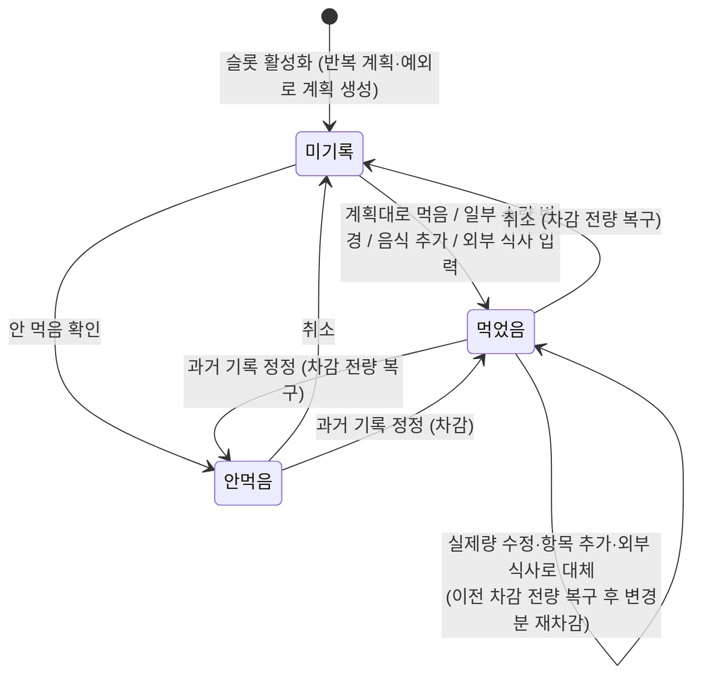
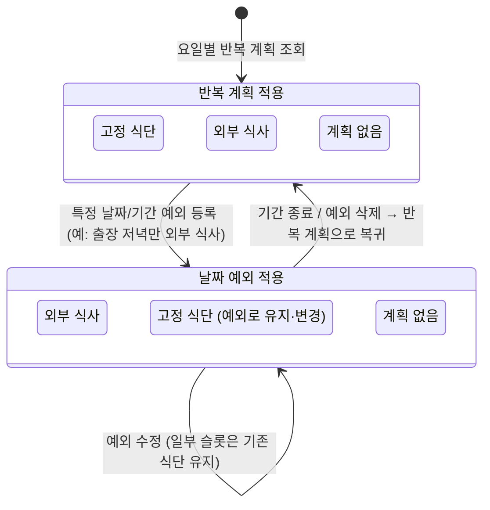
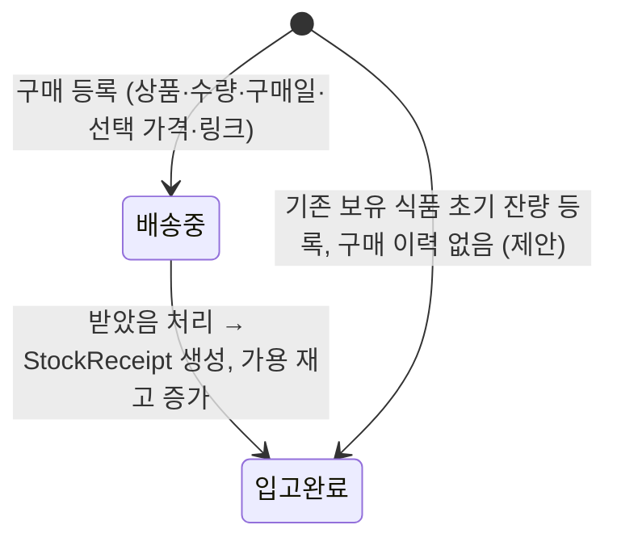
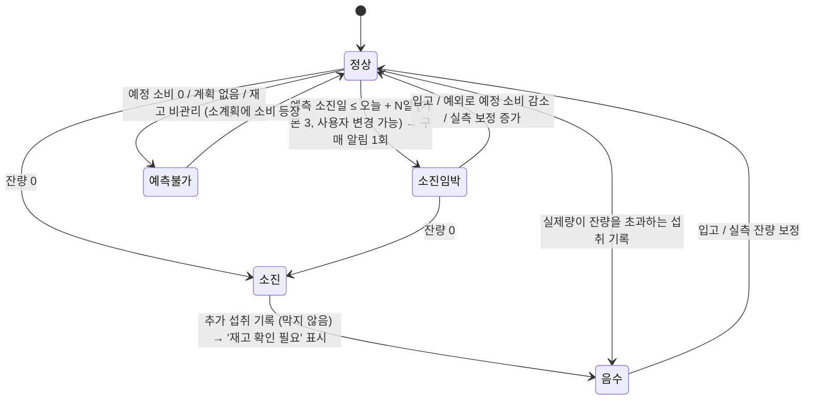
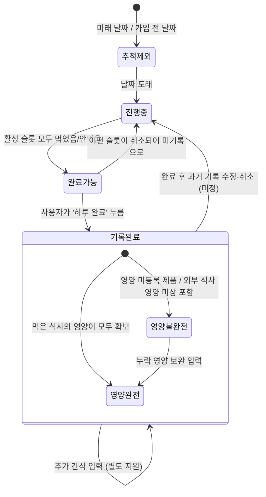
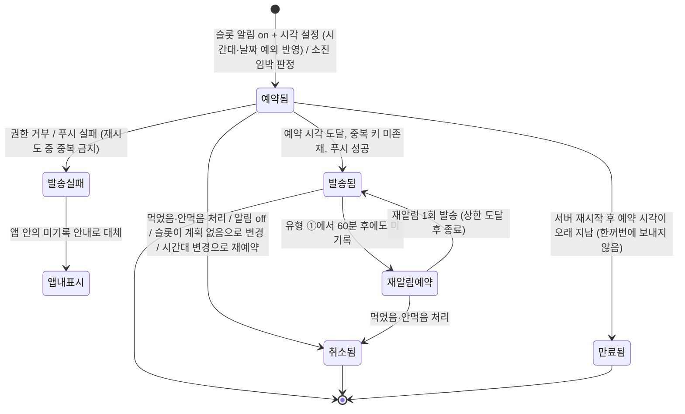
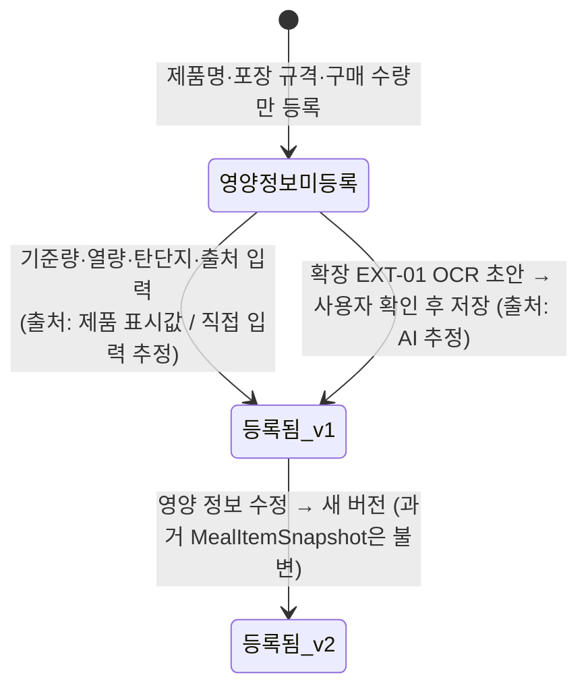
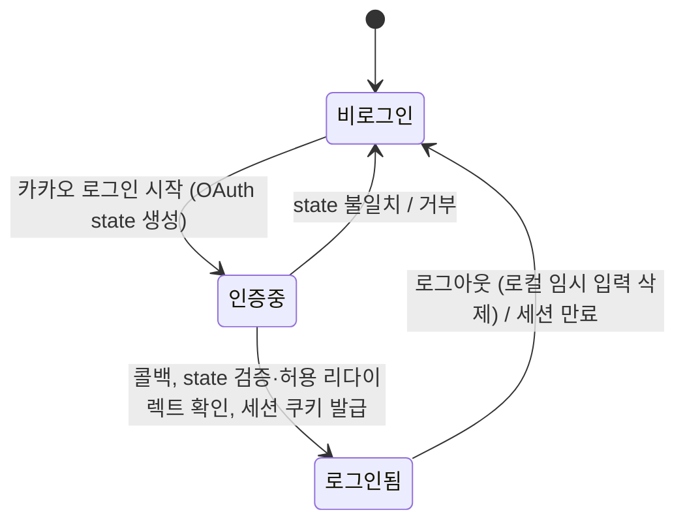
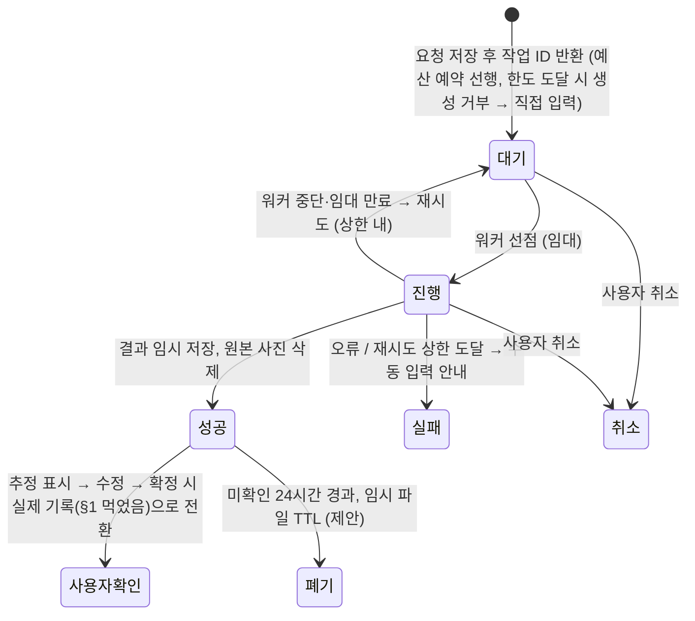

# 식단·재고·체중 관리 웹앱 — 상태 전이도 (1차 범위 기준)

버전: v0.1 / 근거: [`requirements-phase1.md`](requirements-phase1.md), [`extension-todo.md`](extension-todo.md) (2026-11-03) / 전달 대상: Claude Code

두 루트 문서에 산문으로 흩어진 상태 전이(FR-03·05·06·08·09, NFR-02·05, 검토 메모 1~6)를 개체별 상태 기계로 모았다. 상태명은 문서 용어를 그대로 쓴다. 문서에 없는 상태·전이는 **[제안]**, 결정이 필요한 것은 **[미정]**으로 표시한다. 확정 요구가 아닌 항목을 확정으로 오해하지 않는다.

## 1. 식사 기록 (MealRecord) — FR-05, NFR-02

핵심 상태 기계. 상태는 **세 가지뿐**이고 ‘다르게 먹음’은 상태가 아니라 동작이다.

| 전이 | 재고(StockMovement) | 영양 합계 | 알림 | 비고 |
| --- | --- | --- | --- | --- |
| 미기록 → 먹었음 | 집 제품 항목만 실제량 기준 차감. 외부 식사는 차감 없음(추가한 집 제품만 차감). 소스 제외 | 실제량 스냅샷(MealItemSnapshot)으로 합산. 외부 식사 영양 미입력이면 ‘미상’ | 해당 슬롯 미기록 재알림 중지 | 식사 상태 변경과 재고 변경은 1 트랜잭션. 멱등성 키로 재전송·중복 클릭 차단 |
| 미기록 → 안먹음 | 없음 | 섭취 0으로 확정 | 재알림 중지 | ‘안 먹음’은 0, ‘미기록’은 미상 |
| 먹었음 → 먹었음(수정) | 복구 후 재차감, 이동 이력 2건 | 스냅샷 갱신 | — | 시나리오 3: 30→28→29 |
| 먹었음 → 미기록(취소) | 전량 복구 | 스냅샷 제거 | 당일·미래면 재알림 재개 **[제안]** | 시나리오 3: 29→30 |
| 어떤 상태든 (계획 변경) | 없음 | 없음 | — | 계획 변경은 확정된 기록을 수정하지 않음(FR-04). 미기록 슬롯의 ‘예정 내용’만 바뀜 |

가드: 먹었음 체크 전에는 실제 영양 합계·재고를 바꾸지 않는다. 재고 부족이어도 전이를 막지 않고 원장을 음수로 둔다(→ §3).

## 2. 슬롯 계획 유형 (WeeklySchedule / DateOverride) — FR-04

날짜·슬롯마다 해석된 계획 유형. 예외(DateOverride)가 반복 계획(WeeklySchedule)보다 우선한다.

- 전이 부수효과: 소진 예측 재계산(§3), 알림 유형 변경(고정 식단=섭취 체크 안내, 외부 식사=사전 메뉴 기록 안내, 계획 없음=알림 없음 **[제안]**).
- 가드: 이미 **먹었음/안 먹음**으로 확정된 MealRecord는 계획 전이로 바뀌지 않는다. 미기록 슬롯의 예정 내용만 바뀐다.
- 통계: 외부 식사로 **사전** 변경된 슬롯은 계획 실천율 분모에서 제외. 변경 시점을 기록한다.
- **[미정]** ‘계획 없음’ 슬롯이 하루 완료의 활성 슬롯에 포함되는지(검토 메모 4, 제안: 미포함).

## 3. 구매·입고·재고 (Purchase / StockReceipt / StockMovement) — FR-03, FR-08

### 3-a. 구매 건

- 배송 중 수량은 가용 재고·소진 예측에 합산하지 않는다.

### 3-b. 제품 재고 수준 (원장 잔량 + 예측에서 파생)

원장 이동(StockMovement) 종류와 부호

| 이동 | 부호 | 발생 전이 |
| --- | --- | --- |
| 입고 | + | 배송중→입고완료, 초기 잔량 등록 |
| 섭취 차감 | − | MealRecord 미기록→먹었음, 안먹음→먹었음 |
| 섭취 복구 | + | MealRecord 취소·정정·수량 수정의 복구 단계 |
| 폐기 / 다른 용도 소비 | − | 수동, 사유·변경량 기록 |
| 실측 잔량 보정 | ± | 수동, 사유 기록 |

소진 예측 재계산 트리거: 날짜 예외 등록·해제, 입고, 실제 소비량 변경(기록·수정·취소), 수동 보정. 오늘 이미 먹은 양은 예정량에서 다시 차감하지 않는다. 미기록 과거 식사는 소비로 단정하지 않고 신뢰도 낮음을 안내한다.

- **[미정]** 음수 원장에서 소진 예측 표시(‘이미 소진’ vs 예측 계속) — 검토 메모 5.
- **[미정]** 재고 단위(팩)와 섭취 단위(g) 불일치 시 소수 재고 허용 여부, 포장 중량 없는 제품에 g 섭취 입력 시 처리 — 검토 메모 1.
- **[미정]** 소스의 ‘재고 비관리’ 모델링 — 검토 메모 2.

## 4. 하루 완료 (DayCompletion) — FR-06

통계 반영 규칙(전이가 아니라 상태에서 파생)

| 상태 | 주간 기록 완료율 분자 | 주간·월간 영양 평균 | 연속 기록 |
| --- | --- | --- | --- |
| 추적제외 | 분모에서도 제외 | 제외 | 끊지 않음 |
| 진행중 / 완료가능 | 미포함 | 제외(미기록 = 미상) | 끊김 |
| 기록완료·영양불완전 | 포함 | 제외, 이유 표시 (‘기록된 합계’로만 표기) | 유지 |
| 기록완료·영양완전 | 포함 | 포함(유효일) | 유지 |

유효일 0일이면 평균은 0이 아니라 ‘데이터 없음’.

- **[미정]** 완료 후 수정 시 완료 유지/해제와 통계 재계산 시점 — 검토 메모 3.
- **[미정]** ‘계획 없음’ 슬롯의 활성 포함 여부 — 검토 메모 4.

## 5. 알림 전달 (NotificationDelivery) — FR-09, FR-08, NFR-05

단위: (사용자, 날짜, 슬롯 또는 제품, 알림 유형) 1건. 이 키로 중복 발송을 막는다.

알림 유형: ① 고정 식단 섭취 체크 안내 ② 외부 식사 사전 메뉴 기록 안내(예정 시각 또는 10분 전) ③ 미기록 재알림(기본 1회·60분 후) ④ 소진 예측 구매 알림(기본 3일 전). **[제안]** ①~④ 모두 같은 푸시·중복 방지 체계를 공유하고 유형으로 구분(검토 메모 6).

- 외부 식사 알림은 1차에서 촬영·분석 화면으로 유도하지 않는다(사진 분석은 EXT-02).
- 도착 시각 보장을 표현하지 않는다.

## 6. 제품 영양 정보 (Product / ProductNutritionVersion) — FR-02

- 미등록 상태인 제품을 쓰는 식단 합계는 ‘불완전’으로 표시(→ §4 영양불완전).
- 개수↔g 변환은 실제 포장 중량이 있을 때만 활성화.

## 7. 계정 세션 · 목표 · 체중 (간단)

- 목표(GoalHistory): 새 목표 입력 → 지정 날짜부터 ‘적용 중’, 이전 목표는 ‘이력’으로 보존. 과거 실천 평가는 당시 목표로 계산.
- 체중(WeightRecord): 날짜별 ‘미측정’ → ‘측정됨’(입력) → 덮어쓰기 확인 후 수정 → 삭제로 ‘미측정’ 복귀. 미측정일은 0이 아니라 평균에서 제외하고 측정 횟수를 표시.

## 8. (확장 참고, 1차 구현 금지) AI 작업 (AnalysisJob) — extension-todo.md

## 9. 상태 기계 간 연동 요약

| 원인 전이 | 영향 받는 기계 |
| --- | --- |
| §1 미기록→먹었음/안먹음 | §3 원장 차감(먹었음·집 제품만), §4 완료가능 판정, §5 해당 슬롯 알림 취소, §3-b 소진 예측 재계산 |
| §1 취소·수정·정정 | §3 복구 후 재차감, §4 완료가능↔진행중(완료 후면 **[미정]**), §3-b 재계산 |
| §2 예외 등록·해제 | §3-b 예정 소비 변경 → 재계산, §5 알림 유형 변경·재예약, 계획 실천율 분모 변경 |
| §3-a 받았음 / 수동 보정 | §3-b 수준 전이, 소진 알림 예약·취소 |
| §3-b 정상→소진임박 | §5 유형 ④ 예약 |
| §6 미등록→등록 | §4 영양불완전→영양완전 재판정(당일 이후만; 과거 스냅샷 불변) |
| §7 로그아웃 | 로컬 임시 입력 삭제, 미전송 입력은 ‘저장 완료’로 표시되지 않음 |

## 10. 미정 전이 목록 (구현 전 결정)

1. 하루 완료 후 기록 수정 시 완료 유지/해제 (§4, 검토 메모 3)
2. ‘계획 없음’ 슬롯의 활성 포함 여부 (§2·§4, 검토 메모 4)
3. 음수 원장에서 소진 예측 표시 (§3-b, 검토 메모 5)
4. 팩↔g 단위 불일치와 소수 재고 (§3, 검토 메모 1)
5. 소스 ‘재고 비관리’ 모델링 (§3, 검토 메모 2)
6. 식사 알림과 소진 알림의 체계 공유 (§5, 검토 메모 6, 제안: 공유)
7. 취소 시 재알림 재개 여부 (§1→§5, 문서에 없음, 제안: 당일·미래만 재개)

## 11. 인수 시나리오 대응

| 시나리오 (requirements-phase1 §4) | 관련 상태 기계 |
| --- | --- |
| 1 영양 없이 등록 → 영양 누락 표시 | §6 영양정보미등록, §4 영양불완전 |
| 3 30팩 → 28 → 29 → 30 | §1 먹었음 전이·수정·취소, §3 차감/복구 |
| 4 중복 요청·재전송·동시 수정 | §1 멱등성 가드 |
| 5 출장 외부 식사 → 예정 소비만 감소 | §2 예외, §3-b 재계산, §1 확정 기록 불변 |
| 6 외식 열량 미상 → 완료 가능, 평균 제외 | §4 기록완료·영양불완전 |
| 8 알림 끄기·먹었음·시간대 변경 후 알림 없음 | §5 취소됨·재예약 |

## 12. ERD 초안 enum 대응 (erd.md v0.1 기준, 둘 다 제안)

| 상태 기계 | 이 문서의 상태 | `erd.md` enum |
| --- | --- | --- |
| §1 MealRecord | 미기록 / 먹었음 / 안먹음 | `status`: unrecorded / eaten / skipped |
| §2 계획 유형 | 고정 식단 / 외부 식사 / 계획 없음 | `plan_type`: template / outside / none |
| §3-a Purchase | 배송중 / 입고완료 | `status`: ordered / received (ERD는 cancelled도 제안, 본 문서 미포함) |
| §3 StockMovement | 입고·초기 / 섭취 차감 / 섭취 복구 / 보정 / 폐기·타용도 | `reason`: receipt·initial / consume / consume_reverse / adjust / waste·other_use |
| §5 NotificationDelivery | 예약됨 / 발송됨 / 발송실패 / 취소됨·만료됨 | `status`: pending / sent / failed / skipped |
| §5 알림 유형 ①~④ | 식사 체크 / 외부 사전 / 미기록 재알림 / 소진 | `type`: meal_check / outside_pre / unrecorded_remind / stock_depletion |
| §6 영양 출처 | 표시값 / 직접 입력 추정 / AI 추정 | `source`: label / manual_estimate / ai_estimate |
| §8 AnalysisJob | 대기 / 진행 / 성공 / 실패 / 취소 | `status`: pending / running / succeeded / failed / cancelled |

§3-b 재고 수준(정상·소진임박·소진·음수·예측불가)과 §4 하루 완료의 영양완전/불완전은 저장 컬럼이 아니라 원장 잔량·예측·스냅샷에서 계산하는 파생 상태다.
